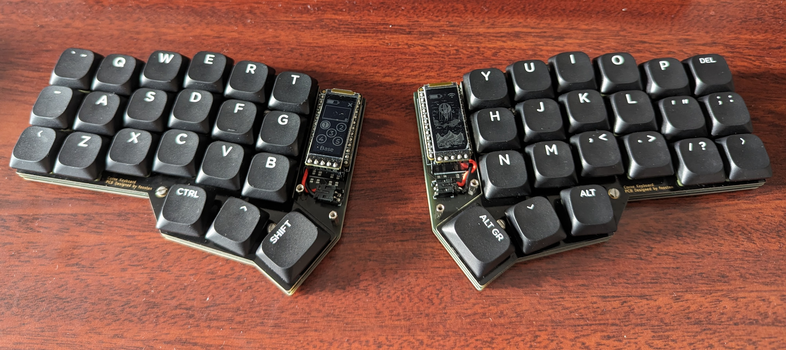
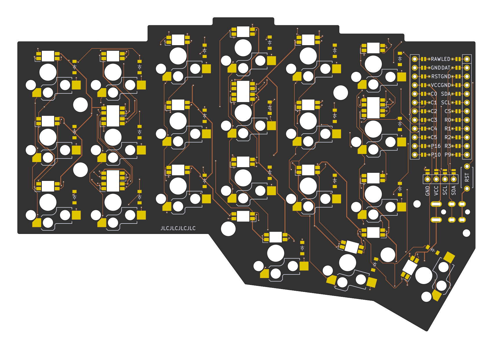
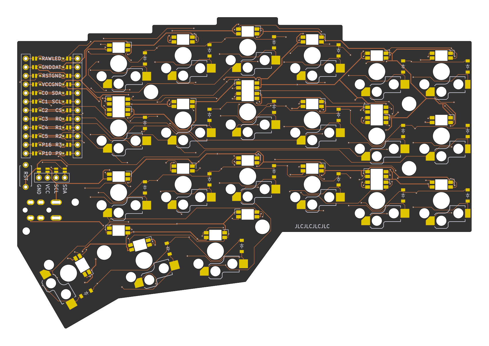
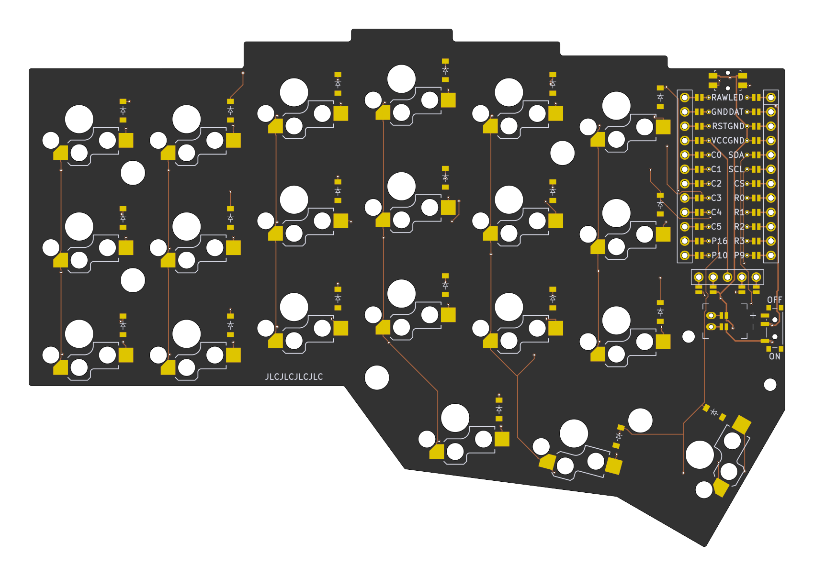
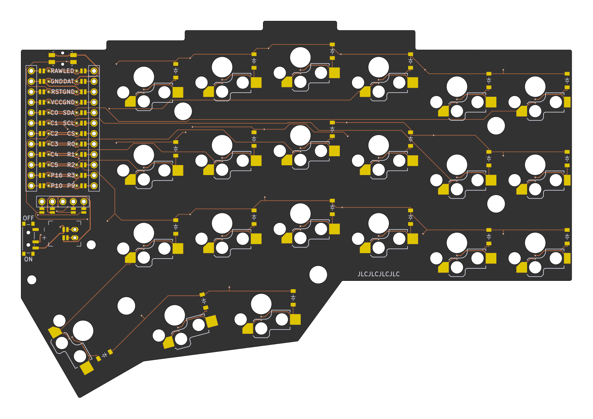

<h1 align="center">C O R N E Y &nbsp; I S L A N D</h1>

A Corne-compatible split keyboard, defined in code with Ergogen.

  

Corney Island is a **42-key column-staggered split keyboard** with wired and wireless PCB variants. It takes inspiration from [foostan’s Corne (crkbd)](https://github.com/foostan/crkbd) and [soundmonster’s Samoklava](https://github.com/soundmonster/samoklava), and brings the layout, electronics, plates, and case geometry together in a programmable design.

The board is **pin-compatible with crkbd v3 QMK firmware**, and its layout is **dimensionally 100% compatible with crkbd v3 plates and cases**.

▲ My wireless **v0.1** build, which has been my daily driver since **January 2024**, with no known issues to report. The current design in this repository is **v0.4**.

***

## LAYOUT

Each half has a 3 × 6 finger matrix and three thumb keys. The current **v0.4** configuration uses **Choc v2 switches**, hot-swap footprints, and **19 mm horizontal and vertical key spacing**.

The source also contains MX and Choc v1 presets. These are customization starting points: changing a preset can change dimensions, and switch footprints and plate cutouts must be adjusted together. The crkbd v3 dimensional compatibility statement applies to the current layout.

***

## PCB

Both variants use a reversible PCB design with a Pro Micro / nice!nano-style controller footprint.

| | Wired | Wireless |
| --- | --- | --- |
| Board | `corney_island` | `corney_island_wireless` |
| Firmware | crkbd v3-compatible QMK | ZMK shield linked below |
| Display footprint | SSD1306 OLED | nice!view |
| Connection between halves | TRRS | Wireless |
| Lighting footprints | Per-key RGB and six underglow LEDs per half | None |
| Additional hardware | Through-hole reset switch | Side-mounted power and reset switches; JST-PH battery connector |

### Wired

| Top | Bottom |
| --- | --- |
|  |  |

### Wireless

| Top | Bottom |
| --- | --- |
|  |  |

The [KiCad files](pcbs/) and [Gerber archives](gerbers/) are included in this repository.

**Fabrication status:** the saved v0.4 [wired](reports/routing/corney_island-autorouted.json) and [wireless](reports/routing/corney_island_wireless-autorouted.json) autorouting reports dated October 25, 2026 show no unconnected items and no DRC errors; footprint-library warnings remain. The separate [frontplate report](reports/routing/frontplate.json) still contains an outline error. See the [generation and validation guide](docs/ergogen.md#routing-and-fabrication) before producing new fabrication files. The [routing investigation](reports/routing/README.md) contains historical results.

***

## CASE & PLATES

The board layout is dimensionally **100% compatible with crkbd v3 plates and cases**, so you can use the existing Corne v3 ecosystem.

This repository also includes its own generated parts:

- [Bottom tray](cases/): JSCAD source and a printable STL.
- [Switch plate](outlines/frontplate.svg): [SVG](outlines/frontplate.svg), [DXF](outlines/frontplate.dxf), and [KiCad PCB](pcbs/frontplate.kicad_pcb).
- [Backplate](outlines/backplate.svg): [SVG](outlines/backplate.svg), [DXF](outlines/backplate.dxf), and [KiCad PCB](pcbs/backplate.kicad_pcb).
- [Controller overlay](outlines/controller_overlay.svg): [SVG](outlines/controller_overlay.svg), [DXF](outlines/controller_overlay.dxf), and [KiCad PCB](pcbs/controller_overlay.kicad_pcb).

Controller, display, socket, and battery heights still determine the clearance needed for a particular build.

***

## MY BUILD

The wireless v0.1 keyboard pictured above uses:

| Part | Hardware |
| --- | --- |
| Controller | nice!nano v2 |
| Display | nice!view |
| Controller sockets | [Typeractive EZ-Solder machine sockets and headers](https://typeractive.xyz/products/ez-machine-sockets-and-headers) |
| Battery | [Typeractive 3.7 V, 110 mAh 301230 lithium-ion battery](https://typeractive.xyz/products/lithium-battery-110mah) |
| Plates | crkbd v3 PCB plates |
| Switches | [Lofree Ghost, Choc v2 POM](https://www.lofree.co/products/lofree-ghost-switches) |
| Keycaps | [XVX Low Profile PBT, white-on-black](https://www.amazon.com/dp/B0CBMQH8H8) |

These parts document the v0.1 build. A complete bill of materials for v0.4 is not included.

***

## MADE WITH ERGOGEN

**The board is defined programmatically in [`ergogen/config.yaml`](ergogen/config.yaml).** That file describes key spacing, column stagger, thumb positions, mounting holes, board and plate outlines, footprint placement, electrical nets, and the bottom tray. The wired and wireless PCBs share a common definition and add their own peripherals.

[Ergogen](https://github.com/ergogen/ergogen) turns this configuration into KiCad PCBs, SVG/DXF outlines, and JSCAD case geometry. The local build converts the case to STL; a separate KiCad, Freerouting, and KiBot pipeline routes the boards, checks them, and exports manufacturing files.

To modify the design, edit the YAML and regenerate the outputs. Layout dimensions and component positions can be expressed as variables and relationships, keeping the different parts of the keyboard tied to the same source.

The button opens the GitHub version of this project in [Ergogen’s web editor](https://github.com/ergogen/ergogen-gui). See the [generation guide](docs/ergogen.md) for local setup, configuration changes, and the routing workflow.

***

## FIRMWARE

### Wired · QMK

Corney Island is **pin-compatible with crkbd v3 QMK firmware**. Use the crkbd v3 configuration appropriate to your controller and enable the peripherals fitted to your board. Choose firmware for the controller you installed.

### Wireless · ZMK

The wireless variant has its own shield repository:

**[Corney Island Wireless ZMK shield](https://github.com/ceoloide/corney-island-wireless-zmk-shield)**

Use that repository as the starting point for the wireless firmware configuration.

***

## CREDITS

- [Corne / crkbd](https://github.com/foostan/crkbd) by [foostan](https://github.com/foostan): the layout and compatibility foundation.
- [Samoklava](https://github.com/soundmonster/samoklava) by [soundmonster](https://github.com/soundmonster): inspiration for this project.
- [Ergogen](https://github.com/ergogen/ergogen) and its contributors: the keyboard generator.
- [ceoloide’s Ergogen footprints](https://github.com/ceoloide/ergogen-footprints): the footprint library included as a Git submodule.
- [Ergogen GUI](https://github.com/ergogen/ergogen-gui): the web editor and the logo used in the Edit on Ergogen button. See [asset attribution](docs/assets.md).
- [TOTEM](https://github.com/GEIGEIGEIST/TOTEM), [KLOR](https://github.com/GEIGEIGEIST/KLOR), and [KLOTZ](https://github.com/GEIGEIGEIST/KLOTZ) by [GEIGEIGEIST](https://github.com/GEIGEIGEIST): inspiration for this documentation’s structure.

***

## LICENSE

[MIT](LICENSE) · Copyright © 2024 Marco Massarelli.
